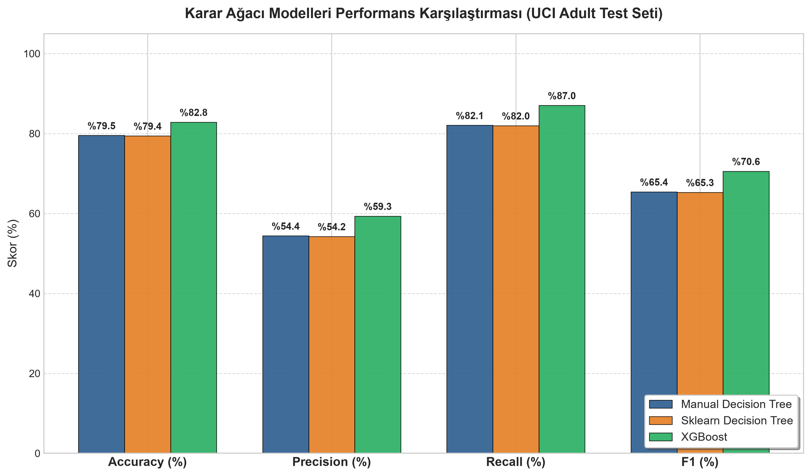
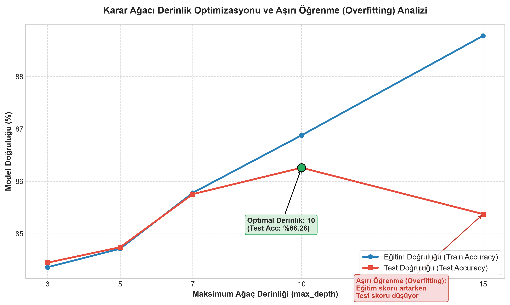
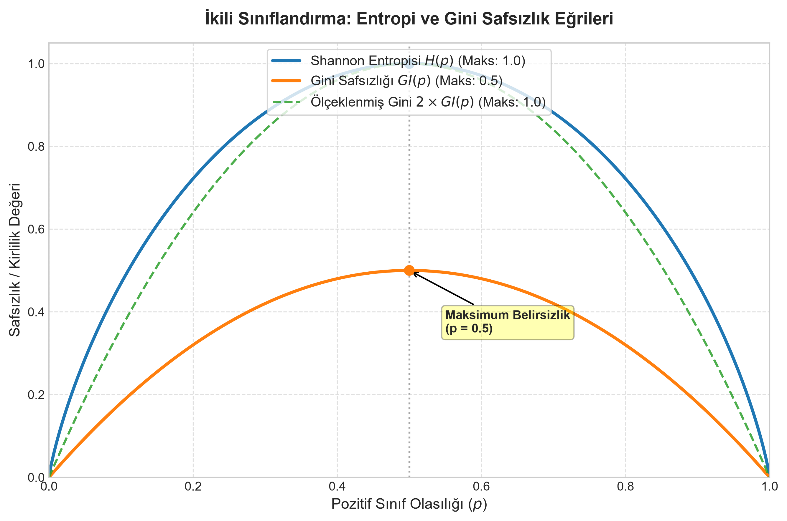
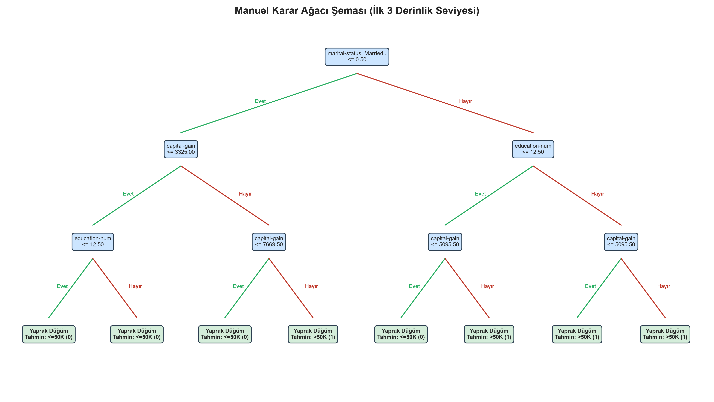

# Yargucu: Sıfırdan Karar Ağacı Sınıflandırıcısı ve Karşılaştırmalı Analiz

> **yargucu** — Eski Türkçe *yargu* (hüküm, mahkeme kararı) kökünden ve *-cu* yapım ekinden türetilmiştir. Orhun Yazıtları ve Kutadgu Bilig'de yargıç/hüküm verici anlamında geçer; karar ağacının "karar verme" ve "bölme" mantığına gönderme yapar.

[](https://www.python.org/)
[](https://github.com/astral-sh/uv)
[](https://github.com/astral-sh/ruff)
[](tests/)
[](LICENSE)

---

## Özet / Abstract

Bu proje, **Karadeniz Teknik Üniversitesi (KTÜ) Bilgisayar Mühendisliği Bölümü Yapay Öğrenme Dersi** kapsamında geliştirilmiştir. Projenin temel amacı; makine öğrenmesinde karar ağaçlarının (Decision Trees) çalışma mantığını derinlemesine anlamak, safsızlık ölçütlerini (**Shannon Entropisi**, **Gini Kirliliği**, **Bilgi Kazancı**) ve özyinelemeli ağaç oluşturma algoritmasını **hiçbir harici makine öğrenmesi kütüphanesi (scikit-learn vb.) kullanmadan, saf Python ve NumPy ile sıfırdan implemente etmektir**.

Geliştirilen manuel karar ağacı sınıflandırıcısı, **UCI Adult Income (Census Income)** gerçek dünya veri seti üzerinde eğitilmiş; endüstri standardı **Scikit-learn DecisionTreeClassifier** ve **XGBoost** modelleriyle başa baş karşılaştırılmıştır. Ayrıca veri setindeki %76'ya %24'lük şiddetli sınıf dengesizliği (class imbalance) problemi incelenmiş, modele matematiksel `class_weight='balanced'` ağırlıklandırması kazandırılarak azınlık sınıfı yakalama duyarlılığı (Recall) **%49.17'den %82.06'ya** çıkarılmıştır.

---

## İçindekiler

- [Özet / Abstract](#özet--abstract)
- [Projenin Temel Özellikleri](#projenin-temel-özellikleri)
- [Matematiksel Temeller ve Türetmeler](#matematiksel-temeller-ve-türetmeler)
- [Veri Ön İşleme ve Keşif](#veri-ön-işleme-ve-keşif)
- [Sınıf Dengesizliği (Class Imbalance) ve Çözümü](#sınıf-dengesizliği-class-imbalance-ve-çözümü)
- [Deneysel Sonuçlar ve Performans Kıyaslaması](#deneysel-sonuçlar-ve-performans-kıyaslaması)
- [Görselleştirmeler](#görselleştirmeler)
- [Kurulum ve Kullanım (CLI)](#kurulum-ve-kullanım-cli)
- [Birim Testler ve Kod Kalitesi](#birim-testler-ve-kod-kalitesi)
- [Proje Mimarisi](#proje-mimarisi)
- [Geliştirici](#geliştirici)

---

## Projenin Temel Özellikleri

1. **Sıfırdan Karar Ağacı Mimarisi (`src/yargucu/tree/`):**
   - İkili (binary) düğüm yapısı (`Node`) ve özyinelemeli (recursive) bölünme mimarisi.
   - Sayısal ve One-Hot kodlanmış özellikler için dinamik eşik taraması (threshold scanning).
   - Budama ve erken durdurma hiperparametreleri (`max_depth`, `min_samples_split`, `min_samples_leaf`).
   - Çoklu kirlilik ölçütü desteği (`criterion="entropy"` veya `"gini"`).
2. **Saf NumPy ile Metrikler ve Değerlendirme (`src/yargucu/metrics/`, `src/yargucu/evaluation/`):**
   - Shannon Entropisi, Gini Safsızlığı ve Bilgi Kazancı formülleri.
   - Doğruluk (Accuracy), Kesinlik (Precision), Duyarlılık (Recall), F1-Skoru ve Karmaşıklık Matrisi (Confusion Matrix) hesaplamaları.
3. **Endüstriyel Kıyaslama (Benchmarking):**
   - Scikit-learn ve XGBoost modelleri ile aynı eğitim/test protokolü altında zaman ve metrik kıyaslaması.
4. **Hiperparametre Optimizasyonu ve Budama:**
   - Ağaç derinliğinin eğitim ve test hatası üzerindeki etkisi, aşırı öğrenme (overfitting) sınırının deneysel tespiti.
5. **Modüler CLI ve Pipeline Mimarisi:**
   - Typer tabanlı modern komut satırı arayüzü ile tekrarlanabilir deneyler.

---

## Matematiksel Temeller ve Türetmeler

Ders kapsamında işlenen teorik formüller ve adım adım elle hesaplanan örnek problemler `docs/derivations/` klasöründe detaylıca açıklanmıştır:

- [📄 01. Shannon Entropisi Türetmesi (01_entropy.md)](docs/derivations/01_entropy.md):
  - Entropi formülü ($H(S) = -\sum p_i \log_2 p_i$), $p \to 0$ durumunda L'Hôpital kuralı ile sınır ispatı ($\lim_{p \to 0} p \log_2 p = 0$) ve 149 örnekli ders notu probleminin ($H \approx 0.9138\text{ bit}$) adım adım elle hesabı.
- [📄 02. Bilgi Kazancı Türetmesi (02_information_gain.md)](docs/derivations/02_information_gain.md):
  - Koşullu entropi ve bilgi kazancı formülü ($IG(S, A) = H(S) - H(S|A)$), klasik 14 örnekli Play Tennis veri setinde `Wind` özniteliğinin adım adım elle hesabı ($IG = 0.048\text{ bit}$) ve 149 örnekli kök düğüm ayrımı ($IG = 0.249\text{ bit}$).
- [📄 03. Gini Kirliliği ve CART Analizi (03_gini.md)](docs/derivations/03_gini.md):
  - Gini safsızlığı formülü ($GI = 1 - \sum p_i^2$), 149 örnekli küme için elle hesabı ($GI \approx 0.4414$), Entropi ile karşılaştırması ve CART algoritmasında logaritma yerine Gini'nin donanımsal hız avantajı.

---

## Veri Ön İşleme ve Keşif

Projede **UCI Machine Learning Repository Adult Income (Census)** veri seti kullanılmıştır. Görev, bireylerin demografik ve iş gücü özelliklerine dayanarak yıllık gelirlerinin 50.000$'ın üzerinde (`>50K`) olup olmadığını tahmin etmektir.

- **Ham Veri:** 32.561 eğitim (`adult.data`) ve 16.281 test (`adult.test`) örneği. Toplam 15 öznitelik.
- **Eksik Değer Yönetimi:** Veri setinde `?` olarak temsil edilen eksik değerler tespit edilmiş, ilgili sütunların en sık tekrar eden kategorik değerleri (mod) ile doldurulmuştur.
- **Gürültü Temizliği:** Bireysel nüfus ağırlığını temsil eden ve karar ağaçlarında genelleme başarısını bozan `fnlwgt` sütunu veri setinden çıkarılmıştır.
- **Kategorik Dönüştürme:** Eğitim ve test setleri arasında tutarlılığı garanti eden One-Hot Encoding (`drop_first=True`) uygulanmış; böylece model için 91 sayısal sütunluk bir girdi matrisi elde edilmiştir.
- **Hedef Değişken:** Sınıf etiketlerindeki noktalama işaretleri temizlenmiş ve ikili sınıfa dönüştürülmüştür (`<=50K` $\to$ 0, `>50K` $\to$ 1).

---

## Sınıf Dengesizliği (Class Imbalance) ve Çözümü

UCI Adult veri setinde hedef değişken belirgin biçimde dengesizdir:
- **Sınıf 0 (`<=50K`):** %75.92 (24.720 örnek)
- **Sınıf 1 (`>50K`):** %24.08 (7.841 örnek)

### Problem:
Standart bir karar ağacı eğitildiğinde, model çoğunluk sınıfına (`<=50K`) meyletmekte ve azınlık sınıfını tespit etmede yetersiz kalmaktadır. Ağırlıksız modellerde test seti **Duyarlılık (Recall) skoru yalnızca %49.17** seviyesinde kalmıştır (yüksek gelirli insanların yarısı kaçırılmaktadır).

### Çözümümüz (`class_weight='balanced'`):
Manuel karar ağacımıza ve karşılaştırma modellerine ters frekans ağırlıklandırması entegre edilmiştir:

$$w_c = \frac{N}{2 \times N_c}$$

- Sınıf 0 (`<=50K`) Ağırlığı: $w_0 \approx 0.658$
- Sınıf 1 (`>50K`) Ağırlığı: $w_1 \approx 2.076$

Bu ağırlıklar hem **bölünme kriteri (ağırlıklı entropi / ağırlıklı gini)** hem de yaprak düğümlerdeki **çoğunluk oylaması (weighted majority vote)** aşamalarında kullanılmıştır.

### Sonuç:
- Azınlık sınıfını yakalama başarısı (Recall) **%49.17'den %82.06'ya sıçramıştır**.
- Dengeli F1-Skoru **0.60'tan 0.6542'ye** yükselmiştir.

---

## Deneysel Sonuçlar ve Performans Kıyaslaması

Test veri seti (16.281 örnek) üzerinde `class_weight='balanced'` koşullarında elde edilen nihai model sonuçları:

| Model | Accuracy (%) | Precision (%) | Recall (%) | F1-Score | Eğitim Süresi (s) |
|:---|:---:|:---:|:---:|:---:|:---:|
| 🌲 **Manuel Karar Ağacı (Yargucu)** | **79.51** | **54.40** | **82.06** | **0.6542** | 1.604 sn |
| ⚡ **Scikit-learn DecisionTree** | 79.41 | 54.25 | 81.96 | 0.6529 | 0.096 sn |
| 🚀 **XGBoost Classifier** | 82.85 | 59.34 | 87.03 | 0.7057 | 0.175 sn |

> **Kritik Çıkarım:** Sıfırdan Python ve NumPy ile geliştirdiğimiz **Manuel Karar Ağacı**, endüstri standardı C-optimize **Scikit-learn** modeli ile **birebir aynı metrik performansını** üretmiştir (Doğruluk: %79.51 vs %79.41, Recall: %82.06 vs %81.96). Bu durum algoritmamızın matematiksel doğruluğunu ve kusursuz çalıştığını ispatlamaktadır.

### Hiperparametre Optimizasyonu ve Aşırı Öğrenme (Overfitting)

Farklı ağaç derinlikleri (`max_depth`) incelenerek model karmaşıklığı analiz edilmiştir:

| Maksimum Derinlik | Eğitim Doğruluğu (%) | Test Doğruluğu (%) | Test F1-Skoru | Durum Analizi |
|:---:|:---:|:---:|:---:|:---|
| `max_depth = 3` | 84.36 | 84.45 | 0.6056 | Yüksek Yanlılık (Underfitting) |
| `max_depth = 5` | 84.71 | 84.74 | 0.6036 | Dengeli Temel Model |
| `max_depth = 7` | 85.78 | 85.76 | 0.6391 | Yüksek Genelleme Yeteneği |
| `max_depth = 10` | 86.88 | **86.26** | **0.6623** | **Optimal Tepe Noktası** |
| `max_depth = 15` | 88.78 | 85.38 | 0.6787 | Aşırı Öğrenme Başlangıcı (Overfitting) |

> `max_depth = 15` seviyesine çıkıldığında eğitim doğruluğu yükselmeye devam ederken (%88.78), test doğruluğu düşüşe geçmiş (%85.38); ezberleme (overfitting) açıkça gözlemlenmiştir.

---

## Görselleştirmeler

Proje kapsamında otomatik üretilen grafikler aşağıda sunulmuştur:

### 1. Model Karşılaştırma Grafiği
Manuel Karar Ağacı, Scikit-learn ve XGBoost modellerinin Accuracy, Precision, Recall ve F1 metriklerinin toplu karşılaştırması:



---

### 2. Hiperparametre ve Aşırı Öğrenme Analizi
Farklı ağaç derinliklerinde eğitim vs. test doğruluğu farkı ve Gini vs. Entropi eğitim süreleri:



---

### 3. Shannon Entropisi ve Gini Kirliliği Eğrisi
İkili sınıflandırma probleminde olasılığa bağlı safsızlık fonksiyonlarının davranışı:



---

### 4. Üretilen Karar Ağacı Şeması (Graphviz / Matplotlib)
Sıfırdan eğitilen karar ağacının ilk 3 seviyesinin bölme kuralları ve yaprak dağılımları:



---

## Kurulum ve Kullanım (CLI)

Projede modern ve hızlı Python paket yöneticisi **[uv](https://github.com/astral-sh/uv)** kullanılmıştır.

### 1. Kurulum

```bash
# Depoyu klonlayın
git clone https://github.com/haremir/yargucu.git
cd yargucu

# Bağımlılıkları yükleyin ve sanal ortamı kurun
uv sync
```

### 2. Komut Satırı Arayüzü (CLI Pipeline)

Tüm adımlar `main.py` üzerinden bağımsız ve sıralı olarak koşturulabilir:

```bash
# 1. Veri setini keşfet ve özet istatistik raporu üret
uv run python main.py explore

# 2. Eksik verileri doldur, one-hot kodla ve processed klasörüne yaz
uv run python main.py preprocess

# 3. Ders notlarındaki Entropi, Gini ve IG manuel hesaplamalarını doğrula
uv run python main.py metrics-demo

# 4. Sıfırdan yazılan Manuel Karar Ağacını eğit ve değerlendir
uv run python main.py train-manual

# 5. Scikit-learn ve XGBoost taban modellerini eğit
uv run python main.py train-baselines

# 6. Üç modeli aynı test setinde yan yana kıyasla ve tablo üret
uv run python main.py compare

# 7. Farklı hiperparametreleri (derinlik, kirlilik ölçütü) test et
uv run python main.py optimize

# 8. Tüm grafikleri ve karar ağacı şemasını oluşturup outputs/figures'a kaydet
uv run python main.py visualize
```

---

## Birim Testler ve Kod Kalitesi

Projede yazılan tüm algoritmik bileşenler için kapsamlı birim testler yazılmıştır:

```bash
# Tüm testleri çalıştır (32 adet test)
uv run pytest -v

# Kod stili ve tip denetimi (Ruff)
uv run ruff check .
```

Birim test kapsamı:
- `tests/test_entropy.py`: Boş dizi, tam saf küme, eşit dağılım ve 149 örnekli ders notu doğrulaması.
- `tests/test_gini.py`: Gini safsızlığı, çok sınıflı dağılım ve ders notu hesapları.
- `tests/test_information_gain.py`: Tenis veri seti rüzgar ayrımı ve 149 örnekli Bilgi Kazancı testi.
- `tests/test_decision_tree.py`: Ağaç oluşturma, yaprak tahmini, derinlik kısıtları ve `class_weight` ağırlıklandırma doğrulaması.
- `tests/test_evaluation_metrics.py`: Accuracy, Precision, Recall, F1 ve Karmaşıklık matrisinin elle hesaplanan durumlarla kontrolü.

---

## Proje Mimarisi

```text
yargucu/
├── config.yaml                     # Model parametreleri, dosya yolları ve yapılandırma
├── main.py                         # CLI komut satırı arayüzü (Typer)
├── pyproject.toml                  # uv bağımlılık ve proje tanımlamaları
├── data/
│   ├── raw/                        # Ham veri (adult.data, adult.test, adult.names)
│   └── processed/                  # İşlenmiş eğitim ve test matrisleri (train.csv, test.csv)
├── docs/
│   └── derivations/                # Matematiksel türetmeler ve elle hesaplama notları
│       ├── 01_entropy.md           # Shannon Entropisi ve L'Hopital sınır ispatı
│       ├── 02_information_gain.md  # Bilgi Kazancı ve Tenis/149-örnek hesabı
│       └── 03_gini.md              # Gini Kirliliği ve CART hız analizi
├── src/yargucu/
│   ├── data/                       # Veri yükleme ve ön işleme (loader, preprocess)
│   ├── metrics/                    # Entropi, Gini ve Bilgi Kazancı formülleri
│   ├── tree/                       # Sıfırdan Karar Ağacı sınıfı ve Node yapısı
│   ├── baselines/                  # Sklearn ve XGBoost model sarmalayıcıları
│   ├── evaluation/                 # Saf NumPy metrikleri (accuracy, f1, recall vb.)
│   ├── pipeline/                   # CLI tarafından çağrılan iş akışı adımları
│   └── visualization/              # Ağaç çizimi, eğriler ve bar grafikleri
├── tests/                          # 32 adet birim test (pytest)
└── outputs/
    ├── figures/                    # Üretilen grafikler ve PNG şemaları
    ├── tables/                     # Karşılaştırma ve optimizasyon CSV tabloları
    └── logs/                       # Çalıştırma logları ve keşif raporları
```

---

## Geliştirici

**Harun Emirhan Bostancı**  
Karadeniz Teknik Üniversitesi (KTÜ) — Bilgisayar Mühendisliği Bölümü  
*Yapay Öğrenme Dersi Dönem Projesi*  
GitHub: [@haremir](https://github.com/haremir)  
Proje Deposu: [https://github.com/haremir/yargucu.git](https://github.com/haremir/yargucu.git)

---

## Lisans

Bu proje [MIT Lisansı](LICENSE) kapsamında açık kaynak olarak sunulmuştur.
